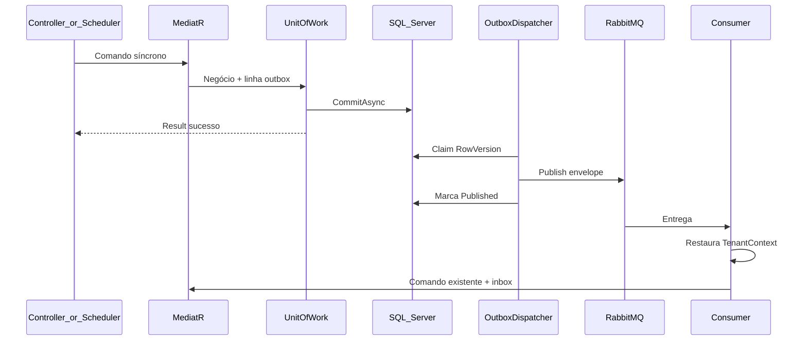

# Mensageria durável (eventos de integração)

> **Fase 0 — contrato** e **Fase 1 — broker no ambiente** (Compose + health check condicional). Ainda **sem** outbox, MassTransit, dispatcher nem publicação de mensagens de negócio. **Sem endpoint HTTP de mensageria.** Decisão formal: [ADR 0052](../adr/0052-rabbitmq-integration-events-and-transactional-outbox.md); ordem de construção: [roadmap](../roadmaps/rabbitmq-messaging-roadmap.md).

## 1. Fase 1 — broker no ambiente (entregue)

| Item | Comportamento |
| :--- | :--- |
| Compose (dev) | Serviço `rabbitmq:4-management`; portas `5672` e `15672` apenas em `127.0.0.1`. |
| Compose (prod) | `rabbitmq:4` sem management; **nenhuma** porta AMQP publicada no host. |
| `Messaging__Enabled=false` (padrão) | Health check `rabbitmq` **não** registrado; `GET /health` segue 200; nenhum handler publica mensagem. |
| `Messaging__Enabled=true` | Health check nomeado `rabbitmq` no `GET /health`; broker inacessível → agregado Unhealthy (503). |
| `GET /api/v1/health` | Inalterado (contrato de negócio sempre `Healthy`). |
| Variáveis | `RabbitMQ__*`, `Messaging__HostRole` (lido; papel efetivo na Fase 10), ver [.env.example](../../.env.example). |

## 2. Diagnóstico do estado atual

A comunicação entre módulos é **in-memory** via MediatR ([ADR 0009](../adr/0009-in-memory-messaging-and-validation-pipeline.md)): `ICommand` / `IQuery`, `ValidationBehavior` e `DomainEventNotification<T>` para `IDomainEventHandler<T>`. Isso permanece correto quando o caller precisa de `Result<T>` na mesma requisição HTTP.

Três lacunas motivam o canal durável:

| Lacuna | Sintoma | ADR / artefato relacionado |
| :--- | :--- | :--- |
| Publish pós-commit | Crash ou falha do handler após `CommitAsync` perde o evento (ex.: `CampaignMetricsSyncedEvent`, eventos do `SocialPublishingUnitOfWork`) | ADR 0009 (limite in-process) |
| Trabalho longo na API | `MetaSynchronizationWorker`, dunning, trial e dispatch orgânico rodam no mesmo processo da Web API; réplicas duplicam laços | — |
| Outbox local sem transporte | `PublicationJob` tem outbox SQL com claim e retry, mas não atravessa processo | [ADR 0046](../adr/0046-organic-publication-outbox-and-dispatch-worker.md) |

O frontend (`WebApp`, `BackofficeApp`) continua **somente** via Web API ([ADR 0020](../adr/0020-zero-direct-db-access-frontend-api-client.md)); nenhum cliente AMQP na UI.

## 3. Fronteira: MediatR vs fila

| Situação | Canal | Motivo |
| :--- | :--- | :--- |
| CRUD, login, RBAC, consulta de dashboard, validação de formulário | MediatR, resposta HTTP | O caller precisa do `Result<T>` na hora. |
| Evento de domínio cujo handler só altera estado já aberto na mesma transação | MediatR, antes ou durante o `CommitAsync` | Consistência local. Não atravessa processo. |
| E-mail transacional (boas-vindas, confirmação, trial, dunning, convite) | Outbox do `MasterDb` → RabbitMQ | SMTP lento e falível; idempotência via `TenantNotificationLog`. |
| Sync de hierarquia e métricas por conta | Scheduler enfileira uma mensagem por conta | Comandos `SyncCampaignHierarchy` / `SyncCampaignMetrics` permanecem. |
| `CampaignMetricsSynced` / `CampaignHierarchySynced` | Outbox do tenant, mesmo commit da ingestão | Pacing, travas e regras precisam de garantia pós-commit. |
| Publicação orgânica no horário | `PublicationJob` é a agenda; fila só executa job devido | ADR 0046; a fila não vira agendador. |
| Geração de cópia/imagem, PDF, relatório | HTTP grava job + outbox e retorna id | Evita segurar request Blazor em APIs externas. |
| Operação em massa com chamada de rede | Uma mensagem por item, com inbox | Falha parcial tolerada (bulk cross-platform). |
| Migração de schema no startup | Hosted service atual | Não é mensagem de negócio. |

## 4. Contrato de envelope (não implementado)

Representação alvo do payload publicado no exchange `admetricspro.integration`. Cabeçalhos AMQP espelham os mesmos campos (`message-id` = `eventId`, `correlation-id`, `message-type`, `occurred-on-utc`, `tenant-id` quando aplicável).

**Regras de validação (fase 2+):**

- `eventId` (GUID) obrigatório e único na outbox.
- `messageType` não vazio, versionado (ex.: `integrations.campaign-metrics-synced.v1`).
- Evento **operacional:** `tenantId` obrigatório; ausência → dead-letter (`Messaging.TenantRequired`).
- Evento de **catálogo:** `tenantId` omitido ou nulo permitido.
- **Proibido** no JSON: tokens OAuth, connection strings, senhas, corpo HTML de e-mail.

**Exemplo de envelope (ilustrativo):**

```json
{
  "eventId": "3fa85f64-5717-4562-b3fc-2c963f66afa6",
  "messageType": "integrations.campaign-metrics-synced.v1",
  "correlationId": "7c9e6679-7425-40de-944b-e07fc1f90ae7",
  "occurredOnUtc": "2026-11-25T18:30:00.000Z",
  "tenantId": "2f8b3c1a-9d4e-4b7c-a1e2-3f4d5e6a7b8c",
  "payload": {
    "connectedAdAccountId": "act_123456789",
    "platform": "Meta",
    "metricsWindowStartUtc": "2026-11-24T00:00:00.000Z",
    "metricsWindowEndUtc": "2026-11-25T00:00:00.000Z"
  }
}
```

Persistência: duas tabelas de **outbox** (nomes físicos e schema **a definir na Fase 3**) — uma no `MasterDb`, outra no banco do tenant — mais **inbox** por consumidor para idempotência de transporte.

## 5. Fluxo alvo (referência)



## 6. Política de ack a partir de `Result`

| Resultado | Ação na mensagem |
| :--- | :--- |
| Sucesso | Ack; grava inbox. |
| `Validation`, `NotFound`, `Conflict`, `Unauthorized` | Ack; log estruturado; sem retry. |
| Falha transitória (429, timeout, SMTP temporário) | Reagenda outbox com `NextAttemptAtUtc`. |
| Exceção inesperada | Retry curto no transporte; depois dead-letter. |
| `EventId` já na inbox | Ack imediato (reentrega). |

## 7. Catálogo de erros do módulo

| Código | Quando | Destino / efeito |
| :--- | :--- | :--- |
| `Messaging.Disabled` | `Messaging__Enabled=false` | Dispatcher não publica; linha outbox permanece `Pending`. |
| `Messaging.TenantRequired` | Evento operacional sem `TenantId` no envelope | Dead-letter; consumidor não abre `DbContext` de tenant. |
| `Messaging.PayloadInvalid` | `EventId` ausente, tipo desconhecido ou JSON incompatível com a versão | Dead-letter. |
| `Messaging.LeaseNotAcquired` | Outra instância detém lease do scheduler | Esta instância não varre outbox; sem publicação neste ciclo. |
| `Messaging.PublishFailed` | Broker recusa publicação | Linha volta a `Pending` com backoff. |

Consumidor **não** usa exceção para forçar retry em falha de negócio coberta por `Result`.

## 8. Fora de escopo (fronteira protegida)

- Substituir MediatR por fila em comando ou consulta síncrona.
- Colocar segredos ou credenciais no corpo da mensagem.
- Revogar `PublicationJob` como agenda ou reescrever `TenantNotificationLog` / chave de `CampaignMetric`.
- Cliente RabbitMQ no Blazor, Backoffice ou browser.
- Endpoints HTTP de mensageria **nesta fase** (consulta de dead-letter e status de job entram em fases posteriores).

## 9. Referências

- [ADR 0052 — RabbitMQ e outbox transacional](../adr/0052-rabbitmq-integration-events-and-transactional-outbox.md)
- [Roadmap de implementação](../roadmaps/rabbitmq-messaging-roadmap.md)
- [ADR 0009 — MediatR in-memory](../adr/0009-in-memory-messaging-and-validation-pipeline.md)
- [ADR 0046 — PublicationJob](../adr/0046-organic-publication-outbox-and-dispatch-worker.md)