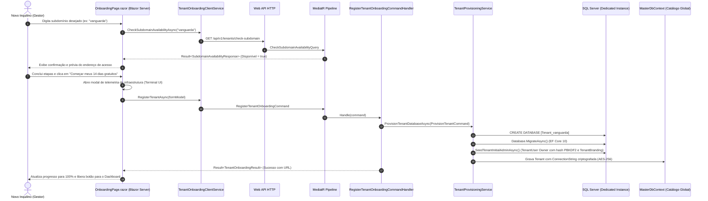

# Especificação Técnica — Onboarding & Provisionamento de Novo Tenant

> **Módulo:** Master / Frontend WebApp (Blazor Server .NET 10)  
> **Rotas:** `/register` e `/onboarding`  
> **Layout:** `LandingLayout.razor` (Full-width clean view)  
> **Design de referência:** Landing page pública do AdMetricsPro.
> **Isolamento de Dados:** Database-per-Tenant (Instância física dedicada no Microsoft SQL Server).

---

## 1. Visão Geral

O módulo de **Onboarding & Provisionamento de Tenant** provê a experiência de autoatendimento (*Self-Service*) e registro guiado para novos assinantes e agências de performance do **AdMetricsPro**. 

A tela acompanha a LP: fundo `#01030f`, superfícies escuras, Inter, destaques azul/ciano, bordas neon e CTAs com gradiente. As etapas Empresa e Administrador são centralizadas; Plano & Recursos usa uma composição centralizada mais ampla. A divisão com a prévia de marca aparece somente em Subdomínio & Identidade, empilhando em telas menores.

O cabeçalho fixo usa a mesma marca e logo da LP. A orientação “Já possui uma conta?” fica separada do botão “Fazer login”.

---

## 2. Arquitetura de Comunicação e Fluxo de Dados



---

## 3. Especificação dos Contratos (Application & WebApi)

### 3.1 Consulta: `CheckSubdomainAvailabilityQuery`
* **Endpoint HTTP:** `GET /api/v1/tenants/check-subdomain?subdomain=vanguarda`
* **Descrição:** Valida em tempo real a unicidade do subdomínio pretendido e bloqueia termos reservados do sistema (`api`, `admin`, `app`, `master`, `auth`, etc.).

#### Retorno de Sucesso (`Result<SubdomainAvailabilityResponse>`):
```json
{
  "isSuccess": true,
  "isFailure": false,
  "value": {
    "subdomain": "vanguarda",
    "isAvailable": true,
    "reason": null,
    "suggestedAlternative": null
  },
  "error": { "code": null, "description": null, "type": 0 }
}
```

---

### 3.2 Consulta: `CheckTaxDocumentAvailabilityQuery`
* **Endpoint HTTP:** `GET /api/v1/tenants/check-document?document=529.982.247-25`
* **Descrição:** Valida em tempo real o formato, a integridade matemática dos dígitos verificadores (módulo 11) e a unicidade no catálogo Master tanto para **CPF (11 dígitos)** quanto para **CNPJ (14 dígitos)**.

#### Retorno de Sucesso (`Result<TaxDocumentAvailabilityResponse>`):
```json
{
  "isSuccess": true,
  "isFailure": false,
  "value": {
    "document": "52998224725",
    "formattedDocument": "529.982.247-25",
    "isValid": true,
    "isAvailable": true,
    "documentType": "CPF",
    "reason": null
  },
  "error": { "code": null, "description": null, "type": 0 }
}
```

---

### 3.3 Comando: `RegisterTenantOnboardingCommand`
* **Endpoint HTTP:** `POST /api/v1/tenants/onboarding`
* **Payload JSON de Entrada:**
```json
{
  "companyName": "Agência Vanguarda Digital Ltda",
  "cnpj": "12345678000195",
  "subdomain": "vanguarda",
  "segment": "Agência de Performance",
  "monthlyAdSpendRange": "R$ 20.000 a R$ 100.000 / mês",
  "tier": "Pro",
  "billingCycle": "Monthly",
  "adminFullName": "Carlos Mendes",
  "adminEmail": "carlos@vanguardadigital.com.br",
  "adminPhone": "11987654321",
  "adminPassword": "SenhaSegura#2026",
  "customDomain": "ads.vanguardadigital.com.br",
  "primaryColor": "#4f46e5",
  "secondaryColor": "#0f172a"
}
```

#### Retorno em Sucesso (`Result<TenantOnboardingResult>`):
```json
{
  "isSuccess": true,
  "isFailure": false,
  "value": {
    "tenantId": "3fa85f64-5717-4562-b3fc-2c963f66afa6",
    "companyName": "Agência Vanguarda Digital Ltda",
    "subdomain": "vanguarda",
    "accessUrl": "https://vanguarda.admetricspro.com.br/dashboard",
    "adminEmail": "carlos@vanguardadigital.com.br",
    "tier": "Pro"
  },
  "error": { "code": null, "description": null, "type": 0 }
}
```

#### Erros de Negócio e Validação Mapeados:
| Código do Erro | Tipo | Descrição |
| :--- | :--- | :--- |
| `Tenant.CompanyNameRequired` | Validation | Razão Social é obrigatória (máx. 200 caracteres). |
| `Tenant.InvalidCnpj` | Validation | Documento fiscal deve conter exatamente 11 dígitos (CPF) ou 14 dígitos (CNPJ) numéricos válidos. |
| `Tenant.InvalidSubdomain` | Validation | Subdomínio inválido ou contendo espaços em branco. |
| `Tenant.InvalidColorHex` | Validation | Cor primária ou secundária fora do formato hexadecimal (`#RRGGBB` ou `#RGB`). |
| `Tenant.InvalidCustomDomain` | Validation | Domínio CNAME personalizado contém protocolo (`http/https`) ou espaços. |
| `Tenant.InvalidBillingCycle` | Validation | Ciclo de faturamento deve ser `Monthly` ou `Annual`. |
| `Tenant.SubdomainAlreadyExists` | Conflict | O subdomínio informado já se encontra alocado por outro assinante. |
| `Tenant.CnpjAlreadyExists` | Conflict | O CPF ou CNPJ informado já possui um ambiente ativo no catálogo. |
| `Tenant.DatabaseAlreadyExists` | Conflict | Instância física de banco SQL Server já existente. |

#### Persistência no Catálogo Global (`MasterDb.Tenants`):
A partir da Subfase 1.1, todos os metadados cadastrais e de personalização coletados no wizard são persistidos diretamente na entidade `Tenant` no catálogo central:
- `Segment` (`nvarchar(100)`, opcional): Segmento de mercado (ex.: "Agência de Performance", "E-commerce").
- `MonthlyAdSpendRange` (`nvarchar(100)`, opcional): Faixa estimada de investimento em anúncios.
- `BillingCycle` (`nvarchar(50)`, opcional): Frequência do faturamento (`Monthly` ou `Annual`).
- `CustomDomain` (`nvarchar(255)`, opcional): Hostname CNAME configurado pelo assinante.
- `PrimaryColor` (`nvarchar(50)`, opcional): Cor primária customizada em formato hexadecimal.
- `SecondaryColor` (`nvarchar(50)`, opcional): Cor secundária customizada em formato hexadecimal.

#### Semeamento Automático no Banco Dedicado do Inquilino (`TenantDbContext`):
A partir da Subfase 1.3, o `TenantProvisioningService` executa o semeamento imediato e idempotente logo após o `MigrateAsync()`:
1. **`TenantBranding`:**
   - Registra as cores primária e secundária personalizadas informadas na etapa de identidade visual.
   - Aplica fallbacks corporativos seguros (`#4F46E5` e `#0F172A`) caso as cores não tenham sido informadas.
2. **`TenantUser` (Administrador / Owner):**
   - Cria o usuário com o perfil `TenantRole.Owner` e `IsActive = true`.
   - Hasheia a senha de forma criptograficamente segura via `IPasswordHasher` (PBKDF2 com salting dinâmico e HMAC-SHA256).
   - Preenche `FullName`, `Email` normalizado em caixa baixa e `PhoneNumber` comercial.

---

## 4. Componentização Frontend Blazor Server

Os componentes do onboarding residem em `src/Frontend/WebApp/Components/Onboarding/`:

| Componente | Responsabilidade |
| :--- | :--- |
| `OnboardingPage.razor` | Página raiz nas rotas `/register` e `/onboarding`. Gerencia o estado do wizard (passos 1 a 4) e orquestra a telemetria do modal de infraestrutura. |
| `OnboardingStepper.razor` | Barra superior de progresso com estados completados e ativo destacado. |
| `StepCompanyInfo.razor` | Etapa 1: Coleta de dados fiscais (Razão Social, CNPJ com máscara, segmento e volume em mídia). |
| `StepSubdomainIdentity.razor` | Etapa 2: Consulta assíncrona de disponibilidade, confirmação contextual, prévia do endereço, CNAME e cores. Respostas de valores anteriores são descartadas. |
| `StepPlanSelection.razor` | Etapa 3: Garantia de 14 dias em primeiro plano, sem cartão; seletor mensal/anual e cards com a mesma aparência da LP. |
| `StepAdminAccount.razor` | Etapa 4: Dados do gestor, botão de mostrar/ocultar em ambos os campos de senha e cinco critérios dinâmicos abaixo deles. |
| `LiveTenantPreviewCard.razor` | Prévia ilustrativa apenas na etapa 2, com URL, marca e cores atualizadas. Valores do cockpit são demonstrativos. |
| `ProvisioningConsoleModal.razor` | Modal em tela cheia com spinner circular, terminal de telemetria em tempo real e CTA de acesso. |

---

## 5. Estratégia de Testes Automatizados (TDD)

- **Backend (`tests/UnitTests/Backend/Tenants/`):**
  - `CheckSubdomainAvailabilityQueryHandlerTests.cs`: Valida subdomínio disponível, reservado e duplicado com sugestão.
  - `RegisterTenantOnboardingCommandTests.cs`: Valida regras estritas do FluentValidation e execução do handler.
- **Frontend (`tests/UnitTests/Frontend/Components/Onboarding/`):**
  - `OnboardingPageTests.cs`: Valida renderização inicial, bloqueio de avanço sem dados obrigatórios, estados do stepper, prévia exclusiva da etapa 2 e bloqueio de avanço enquanto a disponibilidade estiver pendente.


## 6. Experiência de cadastro alinhada à landing page

### Validação de CPF/CNPJ e subdomínio

Os campos usam eventos de digitação (`oninput`) e o cliente HTTP existente. A indicação acompanha a consulta real, sem atraso artificial para simular processamento:

1. Ao editar, a confirmação anterior é invalidada.
2. Documento incompleto ou subdomínio curto apresentam orientação discreta. Documento com dígitos inválidos e subdomínio com caracteres inválidos não enviam consulta de disponibilidade.
3. Durante a consulta, a bolinha giratória acompanha “Verificando CPF…”, “Verificando CNPJ…” ou “Verificando subdomínio…”.
4. Ao confirmar, o texto entra suavemente e o check é desenhado. O estado depende do `Result<T>` e da disponibilidade retornada pela API.
5. Cada consulta recebe uma versão local. Respostas de entradas anteriores não podem substituir o estado do valor atual.
6. O avanço exige a confirmação de documento válido/disponível e de subdomínio disponível. A consulta é de disponibilidade, não reserva o endereço nem garante que outro cadastro não o utilize antes da conclusão; a API continua validando unicidade na criação.

`FieldValidationStatus.razor` reside em `Components/Shared/Components`. O componente usa mensagens específicas, `role="status"`, `aria-live="polite"`, `aria-atomic` e `aria-busy`. Movimento reduzido suspende rotação e transições, mantendo legendas e check legíveis.

Após a confirmação do subdomínio, a área logo abaixo do campo mostra `https://{subdominio}.admetricspro.com.br`. Trata-se de uma prévia, não de um link já provisionado. Ela desaparece quando o campo é editado, durante nova consulta, em entrada inválida ou indisponibilidade. A prévia lateral continua reagindo à paleta; o fundo do mini cockpit usa a cor secundária e o destaque usa a primária.

### Senha do administrador

Os dois campos possuem botões acessíveis de mostrar/ocultar, preservando o valor digitado. O campo principal atualiza os critérios a cada digitação:

- Mínimo de oito caracteres.
- Uma letra maiúscula.
- Uma letra minúscula.
- Um número.
- Um símbolo que não seja espaço, como `!`, `@`, `#`, `$` ou `%`.

Cada regra atendida recebe check, risco horizontal animado e texto cinza; ao remover o caractere que atende a regra, ela volta ao estado pendente. A confirmação informa se as senhas coincidem. O cadastro pelo wizard exige os cinco critérios, confirmação e aceite. A alteração é de apresentação e validação do formulário; o contrato e o validador backend existente não foram alterados.

### Planos e teste gratuito

Os valores saíram da LP e são mostrados em Plano & Recursos. Antes dos cards, a chamada principal destaca **14 dias gratuitos**, **R$ 0 no cadastro** e **nenhum cartão ou dado de pagamento necessário agora**. A frase editorial é:

> Use agora. Deixe o pagamento para quando perceber que está fazendo a melhor escolha para o seu negócio.

O texto explicita que a experimentação dura 14 dias e que a assinatura é uma decisão posterior. O visitante experimenta os recursos do plano escolhido; não é prometida liberação automática de todos os tiers nem aumento garantido de faturamento.

Os três cards preservam superfícies, bordas neon e destaque de Pro usados na LP, com botões de seleção acessíveis por teclado e `aria-pressed`. A seleção permanece no modelo ao avançar/voltar. Valores mensais de referência: Starter R$ 197, Pro R$ 497 e Enterprise R$ 1.497, alinhados aos defaults do checkout. A antiga referência de Enterprise a R$ 1.290 foi substituída. O catálogo efetivo pode alterar valores e limites, que continuam sujeitos à confirmação no checkout.

No ciclo anual, a apresentação aplica os 20% previstos no checkout e exibe o equivalente mensal com centavos e a referência total anual. Nenhum pagamento é processado nesta etapa; os campos de cartão não existem no formulário.

### Fronteiras e testes

As flags `IsTaxDocumentVerified` e `IsSubdomainVerified` pertencem ao estado visual. Não são enviadas no payload de criação; o cliente segue enviando somente os campos do contrato existente. Não houve acesso direto a banco pelo frontend, criação de endpoint nem alteração de provisionamento ou cobrança.

Os testes de experiência foram escritos e executados com falha antes da implementação. A suíte inclui loading real com resposta pendente, confirmação, resposta obsoleta, prévia do endereço, cinco regras de senha, visibilidade da senha, seleção de plano, ausência de valores na LP e disposição correta das quatro etapas.

```bash
dotnet test tests/UnitTests/Frontend/UnitTests.Frontend.csproj --no-restore
```


Validação final: 281 testes de frontend aprovados. A conferência no Chrome percorreu as quatro etapas com um mock somente de consultas, confirmou spinner → check, URL verificada, atualização das cores, seleção de plano e cinco critérios de senha. Desktop de 1440px e tamanhos de 1024px, 390px e 320px foram conferidos, sem rolagem horizontal nas telas verificadas. Não houve criação de conta, provisionamento ou pagamento durante essa conferência.

As regras visuais novas são limitadas a `.onboarding-page-wrapper`; os estilos base preexistentes foram preservados para os componentes de outras telas que os utilizam.
