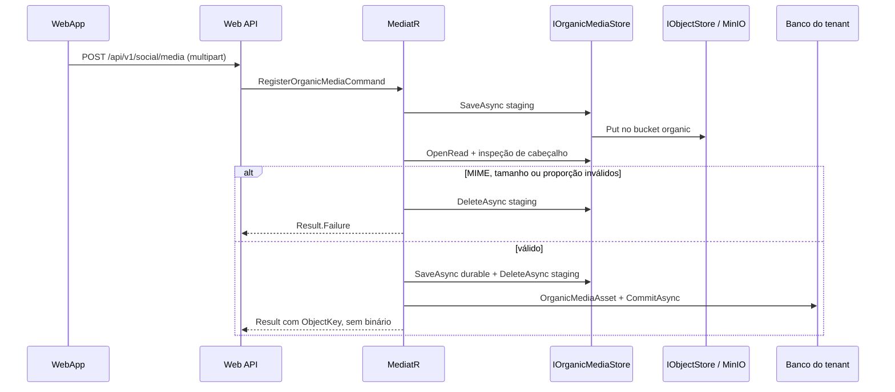

# Roadmap de Implementação: Armazenamento de Arquivos no MinIO

Roadmap técnico para tirar imagens, vídeos e documentos gerados pelo AdMetricsPro do disco local da API e da coluna `varbinary` do SQL Server, sem abrir o MinIO para o browser e sem furar o isolamento por tenant.

Este documento é a ordem de construção. Nenhuma linha de produção de uma subfase começa antes do teste vermelho correspondente. O ciclo é o do `AGENTS.md`: teste que falha, implementação mínima, refatoração com XML docs e atualização de `/docs`.

A decisão formal está em `docs/adr/0053-minio-object-storage.md` e o contrato inicial em `docs/modules/object-storage.md` (Fase 0). Este roadmap é a ordem de construção das Fases 1–7.

---

## 1. Diagnóstico do que existe hoje

Há quatro lugares onde um arquivo pode existir. Só dois guardam binário nosso. Os outros dois não devem ir para o MinIO.

### 1.1 Mídia orgânica (JPEG, PNG, MP4) — disco local, com cliente S3 pronto e desligado

O módulo Social Publishing já separa metadados de binário. A tabela `social.OrganicMediaAssets` guarda `ObjectKey`, MIME, dimensões, duração e proporção. Não há coluna de bytes.

A porta é `IOrganicMediaStore` (`SaveAsync`, `OpenReadAsync`, `DeleteAsync`), com dois tiers:

| Tier | Chave |
| :--- | :--- |
| Staging | `organic-media/staging/{tenantId:N}/{workspaceId:N}/{assetId:N}` |
| Durable | `organic-media/durable/{tenantId:N}/{workspaceId:N}/{assetId:N}` |

`RegisterOrganicMediaCommandHandler` grava em staging, lê o cabeçalho (`OrganicMediaHeaderInspector`), valida domínio e só então promove para durable. Falha de validação chama `DeleteAsync` na chave temporária. O mesmo store recebe o PNG do Nano Banana depois do recorte para 1080×1350 ou 1080×1080 (ADR 0051).

Duas implementações:

* `LocalOrganicMediaStore` quando `SocialPublishing:Media:Provider=Local` (padrão). Raiz `./data/social-media`. No Compose, volume `social-media-data` em `/app/data/social-media`.
* `S3OrganicMediaStore` quando `Provider=S3`. Usa `AWSSDK.S3` 3.7.410.12, `ServiceURL`, `ForcePathStyle=true` e as variáveis soltas `AWS_ACCESS_KEY_ID` / `AWS_SECRET_ACCESS_KEY`.

O Compose de desenvolvimento e o de produção só definem `SocialPublishing__Media__LocalRoot`. Não há serviço MinIO, bucket, `ServiceUrl` nem credencial. Produção e desenvolvimento gravam no volume do container da API. Duas réplicas da Web API não enxergam o mesmo disco. Backup do volume não segue o backup do banco do tenant. O `PublicBaseUrl` é concatenação de string (`ConfigurableOrganicMediaPublicUrlResolver`). Sem essa URL, Instagram (`video_url`), carrossel e TikTok não conseguem buscar o arquivo, e o Blazor baixa o binário pela API para um ticket em memória (`GET /social/media-preview/{ticket}`).

O cliente S3 está registrado dentro de `SocialPublishing.Infrastructure`. Analytics e Tenants não podem reutilizá-lo sem referência cruzada de infraestrutura. Não há teste do store S3; os testes de geração de imagem usam um dicionário em memória.

`S3OrganicMediaStore` devolve `ex.Message` dentro de `Error.Failure`. Falha de storage continua sendo `Result`, o que está certo, mas a mensagem vaza detalhe de infraestrutura para o cliente HTTP.

Teto de upload: `MaxUploadBytes` padrão 110 MB, alinhado a `[RequestSizeLimit(110_000_000)]` em `POST /api/v1/social/media`. MIME permitido: `image/jpeg`, `image/png`, `video/mp4`.

### 1.2 PDF de relatório white-label — `varbinary(max)` no banco do tenant

`GeneratedReport.PdfContent` é `varbinary(max)` nullable no banco operacional do tenant (`ReportEntityTypeConfigurations`). `GenerateReportCommand` compila o PDF com `WhiteLabelReportPdfGenerator` e grava os bytes na mesma linha do `RenderModelJson` e do snapshot de marca. `GET .../reports/{reportId}/pdf` lê essa coluna. O disparo de e-mail anexa o mesmo array.

O ADR 0037 já registrou o custo: dezenas de PDFs por tenant incham o banco, o backup e o restore. A mitigação escrita naquele ADR (regenerar a partir do JSON) não foi o caminho implementado: o binário é persistido. Com a Fase 8 da mensageria (ADR 0052), a compilação saiu do request HTTP, mas o destino do arquivo continua sendo o SQL.

### 1.3 Marca white-label — URL colada, não arquivo

`LightLogoUrl`, `DarkLogoUrl` e `FaviconUrl` são strings HTTPS validadas por extensão (`.png`, `.svg`, `.jpg`, `.jpeg`, `.webp`; favicon também `.ico` e `.svg`). A agência hospeda o arquivo em outro CDN. O login, o header e o portal público de aprovação só renderizam essa URL. O favicon padrão e o mark da landing (`images/landing/brand-mark.svg`, `/favicon.ico`) são arquivos estáticos do `wwwroot` do Blazor.

### 1.4 O que passa pela API e não é arquivo nosso

`POST /api/v1/integrations/meta/media` copia o multipart para um `byte[]` e envia à Graph API (`UploadMetaMediaCommand`). O retorno é hash de imagem ou id de vídeo na conta de anúncios. Nada fica no disco da plataforma. O Creative Hub guarda `PreviewUrl` vinda da rede e, para post orgânico, o SHA-256 da `ObjectKey` (`OrganicMediaFingerprint`). Essas URLs de CDN de terceiros não são cópia nossa.

O frontend não abre storage. `WebApp` e `BackofficeApp` falam só com a Web API (ADR 0020). O upload orgânico é `multipart/form-data` para `POST /api/v1/social/media`. A validação de MIME, tamanho e proporção acontece no servidor, depois do staging.

---

## 2. Premissas travadas antes da Fase 1

1. **MinIO é o deployment. A API S3 que já existe é o cliente.** Não entra um segundo SDK (`Minio` NuGet) ao lado de `AWSSDK.S3`. `ForcePathStyle` e `ServiceURL` permanecem, porque é assim que o MinIO fala o protocolo S3. O nome da configuração passa a ser `ObjectStorage`, não `AWS_*` solto dentro do módulo social.
2. **Um cluster MinIO, buckets por finalidade, prefixo por tenant.** Buckets: `admetricspro-organic`, `admetricspro-reports`, `admetricspro-branding`. Toda chave de objeto nosso começa com `{tenantId:N}/`. Não há bucket por tenant: o provisionamento já cria um banco SQL (ADR 0002); criar bucket por cliente no mesmo fluxo acopla o ciclo de vida do tenant a um limite operacional do MinIO e impede o rollback por flag. Tenant corporativo com bucket dedicado fica fora deste roadmap, no mesmo espírito de instância SQL dedicada, que também não é o padrão.
3. **A chave orgânica não muda.** O valor já gravado em `OrganicMediaAssets.ObjectKey` continua válido dentro do bucket `admetricspro-organic`. A migração do volume local é cópia de arquivo para objeto com a mesma chave. Não há `UPDATE` em massa nessa tabela.
4. **SQL guarda metadado. MinIO guarda byte.** `ObjectKey`, MIME, tamanho e dimensões ficam no banco do tenant (mídia e relatório) ou no registro de branding do tenant. É proibido nova coluna `varbinary` para arquivo. `RenderModelJson` do relatório permanece no SQL: é a fonte para recompilar o PDF se o objeto sumir.
5. **O MinIO não é superfície pública.** Em produção as portas da API S3 e do console não são publicadas no host; ficam na rede `admetricspro-prod-net`, no mesmo desenho do RabbitMQ no ADR 0038. O browser nunca recebe access key, secret, URL pré-assinada de upload nem endpoint do MinIO. Upload continua `multipart` na Web API, porque a validação de cabeçalho, proporção, RBAC e teto de 110 MB já está nesse caminho. Upload direto do browser para o bucket fica fora da v1.
6. **Quem precisa buscar o arquivo de fora é a rede social, e quem entrega é a Web API.** Instagram, Facebook e TikTok fazem GET em uma URL HTTPS no momento da publicação. O ADR 0038 não coloca proxy reverso na stack. A URL pública não aponta para o MinIO. `IOrganicMediaPublicUrlResolver` deixa de concatenar `PublicBaseUrl` + chave crua e passa a emitir um link da própria API com token HMAC de vida curta (padrão 2 horas, teto 24). A rota pública só faz stream do objeto depois de validar o token, o tenant embutido e a chave. Prévia no Blazor autenticado continua em `GET /api/v1/social/posts/{id}/media/{assetId}` mais o ticket curto do circuito; não usa o token de publicação.
7. **Módulos não referenciam o SDK.** A porta `IObjectStore` mora em `BuildingBlocks.Application`. A implementação e o `IAmazonS3` moram em `BuildingBlocks.Infrastructure`. `SocialPublishing.Infrastructure` deixa de referenciar `AWSSDK.S3`. `Domain`, `Application`, `WebApp` e `BackofficeApp` não referenciam o SDK. O gate é o mesmo de `AgentsArchitectureComplianceTests` usado na Fase 2 do ADR 0052.
8. **`IOrganicMediaStore` continua a porta do módulo social.** Ela monta a chave e o tier. Por baixo chama `IObjectStore` no bucket orgânico. Analytics e Tenants não chamam `IOrganicMediaStore`. Relatório e branding têm portas próprias, finas, no respectivo módulo de Application, implementadas na Infrastructure daquele módulo em cima de `IObjectStore`.
9. **Flag de provedor com rollback.** `ObjectStorage:Provider` aceita `Local` (padrão, comportamento atual) e `MinIO`. Com `Local`, nenhum código novo fala com o cluster. O corte de produção é trocar a variável e subir o serviço, não um deploy que apaga o volume no mesmo dia.
10. **Falha de storage é `Result`, sem `throw` de regra.** Código estável `Storage.ObjectNotFound`, `Storage.WriteFailed`, `Storage.ReadFailed`, `Storage.DeleteFailed`. A descrição voltada ao cliente não inclui exceção do SDK, nome do bucket nem endpoint. O log estruturado do servidor fica com o detalhe.
11. **Fora do MinIO.** Arquivos de `wwwroot` (CSS, JS, mark da landing, favicon padrão). URLs de CDN da Meta, Google, TikTok e Bing. O `byte[]` transitório do upload pago, que segue direto para a Graph API. Corpo de e-mail, token OAuth e connection string. Copiar criativo de anúncio para o nosso bucket não faz parte deste roadmap.
12. **Frontend só enxerga a API.** Nenhuma página Blazor ganha cliente S3. Logo enviado pela agência volta no DTO de branding como URL da API (ou a URL externa antiga, se a agência não tiver feito upload).

---

## 3. O que entra em cada bucket

| Origem | Bucket | Chave | Metadado que permanece no SQL | Fora deste corte |
| :--- | :--- | :--- | :--- | :--- |
| Upload `POST /api/v1/social/media` (JPEG, PNG, MP4) | `admetricspro-organic` | a chave atual, com `staging` ou `durable` | `OrganicMediaAssets` | — |
| PNG do Nano Banana após normalização | `admetricspro-organic` | a mesma chave durable que `ReplaceGeneratedImage` já grava | `OrganicMediaAssets` | — |
| PDF de `GeneratedReport` | `admetricspro-reports` | `{tenantId:N}/{workspaceId:N}/{reportId:N}.pdf` | nova coluna `PdfObjectKey`; `PdfContent` sai depois da cópia | `RenderModelJson` |
| Logo claro, logo escuro, favicon enviados no formulário de marca | `admetricspro-branding` | `{tenantId:N}/light`, `{tenantId:N}/dark`, `{tenantId:N}/favicon` | chave opcional ao lado da URL; URL externa continua válida quando não há upload | SVG/PNG já hospedados pela agência |
| Upload Meta `POST /api/v1/integrations/meta/media` | — | — | hash / video id na conta de anúncios | binário não é retido |
| `wwwroot` | — | — | — | permanece no publish do Blazor |

Staging orgânico não confirmado em 24 horas é lixo. A limpeza é política de ciclo de vida do MinIO no prefixo `organic-media/staging/` e, no provedor `Local`, um sweep no mesmo intervalo. Durable e PDF só saem quando o agregado dono é removido ou quando um futuro desprovisionamento de tenant apagar o prefixo `{tenantId:N}/` nos três buckets. Não existe hoje um serviço de drop de tenant; o método de exclusão por prefixo entra na Fase 7 para esse gancho, sem inventar o fluxo de cancelamento.

---

## 4. Topologia alvo

Um serviço `minio` na rede Docker já usada pelo SQL e pelo RabbitMQ. Imagem `minio/minio` com `server /data`. Volume nomeado `minio-data` (dev) e `minio-prod-data` (prod). Healthcheck em `mc ready local` ou no endpoint de live do processo, no padrão `service_healthy` do ADR 0038.

| Peça | Dev | Produção |
| :--- | :--- | :--- |
| API S3 | publicada só em `127.0.0.1`, porta `9000` | sem publicação no host |
| Console | publicada só em `127.0.0.1`, porta `9001` | sem publicação no host |
| Credencial | `.env`, nunca no Git (ADR 0018) | `.env` / `.env.prod`, usuário que não é `minioadmin` |
| Buckets | criados na subida por um init único (`minio/mc`) idempotente | o mesmo init, na rede interna |
| Acesso anônimo | desligado nos três buckets | desligado |

Variáveis, no padrão de underscore duplo do ADR 0018:

| Variável | Papel |
| :--- | :--- |
| `ObjectStorage__Provider` | `Local` ou `MinIO`. Padrão `Local`. |
| `ObjectStorage__ServiceUrl` | Endpoint interno, ex. `http://minio:9000`. |
| `ObjectStorage__AccessKey` | Access key. |
| `ObjectStorage__SecretKey` | Secret. |
| `ObjectStorage__Region` | Valor exigido pelo SDK; `us-east-1` basta no MinIO. |
| `ObjectStorage__OrganicBucket` | `admetricspro-organic`. |
| `ObjectStorage__ReportsBucket` | `admetricspro-reports`. |
| `ObjectStorage__BrandingBucket` | `admetricspro-branding`. |
| `ObjectStorage__PublicBaseUrl` | Origem HTTPS da Web API que assina o link de publicação. Vazio mantém o comportamento atual de prévia autenticada e bloqueia publish externo com `Social.MediaPublicBaseUrlMissing`. |
| `ObjectStorage__PublishUrlTtlMinutes` | Vida do token de leitura pública. Padrão 120. Teto 1440. |
| `SocialPublishing__Media__LocalRoot` | Continua valendo só com `Provider=Local`. |
| `SocialPublishing__Media__MaxUploadBytes` | Permanece a regra de produto (110 MB). Não muda de seção. |

`webapi.depends_on` inclui `minio: service_healthy` somente quando o compose daquele ambiente já nasce com `ObjectStorage__Provider=MinIO`. Com `Local`, a API sobe como hoje, sem o cluster.

O init `mc` cria os buckets se não existirem e aplica expiração de 24 horas no prefixo de staging. Não aplica política `public` nem `download`.

---

## 5. Fluxo de um upload orgânico

Publicação no horário (ADR 0046) não abre o MinIO no adaptador. O dispatcher pede a URL ao resolver; o resolver devolve `https://{PublicBaseUrl}/api/v1/public/media/{token}`. O adaptador Meta/TikTok recebe essa URL como já recebe hoje. Na hora em que a rede busca o arquivo, a rota pública valida o token e faz stream a partir de `OpenReadAsync`.

Geração de imagem e compilação de PDF que já rodam em consumidor RabbitMQ (ADR 0052, Fase 8) gravam no MinIO dentro do comando existente. A mensagem continua levando só identificadores. O binário não entra no envelope.

---

## 6. Catálogo de erros novo

| Código | Quando |
| :--- | :--- |
| `Storage.Disabled` | Não usado como falha de request. `Provider=Local` é sucesso no disco. |
| `Storage.ObjectNotFound` | Get ou delete de chave ausente quando o chamador esperava o objeto. Delete de chave já ausente no sweep é sucesso. |
| `Storage.WriteFailed` | Put recusado, bucket inexistente, credencial inválida, timeout. |
| `Storage.ReadFailed` | Get falhou por motivo que não é 404. |
| `Storage.DeleteFailed` | Delete falhou depois de o objeto existir. |
| `Storage.KeyInvalid` | Chave vazia, com `..`, ou fora do prefixo do tenant atual. |
| `Social.MediaPublicBaseUrlMissing` | Já existe. Continua sendo a falha quando se tenta publicar e `PublicBaseUrl` está vazio. |

`Storage.KeyInvalid` é defesa da implementação: a chave montada pelo módulo inclui o tenant do `ITenantContextAccessor`. Um `OpenRead` cujo primeiro segmento não é esse tenant retorna falha e não chama o SDK. Relatório e branding usam a mesma checagem.

---

## 7. Tabela resumo das fases

| Fase | Objetivo | Onde mexe | Entregável |
| :--- | :--- | :--- | :--- |
| **0. Decisão** | Travar fronteira SQL × objeto e o ADR 0053. | `docs/` | ADR 0053, `docs/modules/object-storage.md` com o contrato, linha no catálogo de ADRs. |
| **1. Cluster** | Subir MinIO sem tráfego de negócio. | Compose, `.env.example`, health da API | Três buckets privados, credencial fora do Git, `/health` nomeado. |
| **2. Porta** | `IObjectStore` testável sem rede. | `BuildingBlocks.Application`, compliance | Tipos, testes do fake, SDK proibido fora da Infrastructure. |
| **3. Cliente MinIO** | Put/Get/Delete reais e init de bucket. | `BuildingBlocks.Infrastructure`, Testcontainers | Circuito com `Testcontainers.Minio` (ou imagem MinIO no fixture). |
| **4. Mídia orgânica** | JPEG, PNG, MP4 e imagem gerada passam pelo store compartilhado. | `SocialPublishing` | `Provider=MinIO` em dev opcional; `Local` intacto; URL pública vira token da API. |
| **5. Cópia do volume** | Esgotar `social-media-data` sem trocar `ObjectKey`. | ferramenta de uma execução na Web API | Relatório de chaves copiadas, já existentes e ausentes no disco. |
| **6. PDF** | Tirar `PdfContent` do SQL. | `Analytics`, e-mail de relatório | Coluna `PdfObjectKey`, download e anexo leem o objeto. |
| **7. Marca e retenção** | Upload de logo/favicon e limpeza. | `Tenants`, MinIO ILM, sweep local | URL externa preservada; prefixo de tenant apagável; staging expira em 24 h. |

Cada fase fecha com XML `
` / `<param>` / `<returns>`, atualização de `docs/modules/object-storage.md` e, quando mudar comportamento de módulo já documentado, um parágrafo no `.md` daquele módulo. Endpoint novo leva `[EndpointSummary]`, `[ProducesResponseType]` e entrada no Scalar.

---

## 8. Fases em detalhe

### Fase 0 — Decisão e fronteira

Objetivo: escrever a decisão antes de mudar o Compose. Nenhuma imagem MinIO nesta fase.

* **0.1:** Criar o ADR 0053 no formato Nygard cobrindo as premissas da seção 2, a rejeição de bucket-por-tenant, a rejeição de SDK duplo, a manutenção do ADR 0020 e o adendo ao ADR 0037 (o PDF deixa de viver em `varbinary`; o JSON continua sendo a fonte de recomposição).
* **0.2:** Acrescentar a linha 0053 em `docs/adr/README.md`.
* **0.3:** Abrir `docs/modules/object-storage.md` com o diagnóstico da seção 1, as tabelas das seções 3 e 6 e a frase “sem endpoint HTTP nesta fase”.

### Fase 1 — Cluster no ambiente

Objetivo: o container existe, os buckets existem, a API sabe se ele está vivo, e nenhum handler grava objeto.

* **1.1 (TDD - Red):** Teste do health check: com `ObjectStorage__Provider=MinIO` e endpoint inacessível, o check `minio` fica `Unhealthy`. Com `Provider=Local`, o check fica ausente ou `Healthy` e a API sobe como hoje. O `/health` agregado que o Compose já usa para a API não pode ficar `Unhealthy` só porque o desenvolvedor ainda está em `Local`.
* **1.2 (TDD - Green):** Serviço `minio` e serviço init `minio-init` em `docker-compose.yml` e `docker-compose.prod.yml`. Dev publica `9000` e `9001` em `127.0.0.1`. Prod não publica porta. Volume nomeado. `minio-init` cria os três buckets e a regra de expiração do prefixo de staging, e termina com sucesso se rodar de novo.
* **1.3:** Variáveis na seção 4 em `.env.example` e `.env.prod.example`. Secret só por ambiente. Atualizar `docs/devops/docker-production.md`: rede interna, proibição de expor console e API S3, e a nota de que `Provider` permanece `Local` até a Fase 4 estar verde.
* **1.4:** `AddMinioHealthCheck` condicionado a `Provider=MinIO`.

Critério de saída: `docker compose up` sobe o MinIO saudável com os três buckets privados, e a suíte atual permanece verde com `ObjectStorage__Provider=Local`.

### Fase 2 — Porta sem rede

Objetivo: o contrato de objeto existe e a regra de chave é pura.

* **2.1 (TDD - Red):** Testes de `ObjectKey` rejeitam vazio, `\`, `..`, chave que não começa com o tenant informado e chave de outro tenant. Aceitam a chave orgânica já persistida (`organic-media/durable/{tenant}/{workspace}/{asset}`).
* **2.2 (TDD - Red):** Fake em memória de `IObjectStore` cobre put, get, delete idempotente de ausente, e get de ausente como `Storage.ObjectNotFound`. Put de novo conteúdo na mesma chave substitui.
* **2.3 (TDD - Green):** Interface em `BuildingBlocks.Application.Storage`: `PutAsync`, `OpenReadAsync`, `DeleteAsync`, `ExistsAsync`. Argumentos: bucket, chave, stream, content type, `CancellationToken`. Retorno `Result` / `Result<Stream>`. Nenhum tipo da AWS na assinatura.
* **2.4 (Compliance):** Estender `AgentsArchitectureComplianceTests` para falhar se `WebApp`, `BackofficeApp`, qualquer `*.Domain`, qualquer `*.Application` ou `SocialPublishing.Infrastructure` referenciarem `AWSSDK.S3` ou `AWSSDK.Core`. Pacote permitido só em `BuildingBlocks.Infrastructure`.
* **2.5:** XML docs e a seção de contratos em `docs/modules/object-storage.md`.

### Fase 3 — Cliente MinIO

Objetivo: um teste de integração grava e lê um objeto de verdade. Ainda nenhum módulo de produto usa o cliente.

* **3.1 (TDD - Red):** Fixture sobe MinIO (Testcontainers ou container equivalente ao `SqlServerFixture`). O teste faz put de um buffer pequeno, open-read com os mesmos bytes, delete, e open-read seguinte retorna `Storage.ObjectNotFound`. Bucket ausente retorna `Storage.WriteFailed` sem a mensagem crua do SDK no `Error.Description` exposto.
* **3.2 (TDD - Green):** `MinioObjectStore` em `BuildingBlocks.Infrastructure`, `IAmazonS3` singleton com `ForcePathStyle` e credencial vinda de `ObjectStorage`. Registro `AddObjectStorage(configuration)` usado pela `WebApi`. Com `Provider=Local`, o registro não cria cliente S3; registra `LocalObjectStore` com raiz `ObjectStorage:LocalRoot` (diretório irmão de `SocialPublishing:Media:LocalRoot`, não o mesmo, para a Fase 4 poder copiar de um para o outro).
* **3.3:** Log de falha com endpoint e código do SDK só no `ILogger`. `Error.Description` usa texto estável em português.

Critério de saída: `Provider=Local` não abre socket para a porta 9000 durante a suíte unitária. O teste de integração novo é o único que sobe o container.

### Fase 4 — Mídia orgânica (imagens, vídeos e imagem gerada)

Objetivo: o caminho que já funciona no disco passa a poder usar o MinIO sem mudar o contrato HTTP de `POST /api/v1/social/media` nem o formato de `ObjectKey`.

* **4.1 (TDD - Red):** `LocalOrganicMediaStore` e o adaptador MinIO, dados o mesmo tenant, workspace e asset, produzem a chave da seção 1.1. O adaptador MinIO recusa chave cujo tenant não é o do contexto.
* **4.2 (TDD - Red):** Com `Provider=MinIO`, `RegisterOrganicMediaCommand` grava staging, e um MIME inválido remove o objeto (o fake ou o container não fica com a chave). Com `Provider=Local`, o teste de registro que já existe continua no disco.
* **4.3 (TDD - Red):** `GeneratePostImageCommand` grava o PNG normalizado pela mesma porta. Duas gerações no mesmo post substituem a mídia anterior e apagam a chave antiga, como `ReplaceGeneratedImage` já faz.
* **4.4 (TDD - Red):** Resolver de URL pública, com `PublicBaseUrl` preenchido, devolve URL da API com token, não a chave crua. Token expirado e token de outro tenant recebem 404 na rota pública, sem dizer se o objeto existe. Token válido faz stream com o `Content-Type` gravado. Sem `PublicBaseUrl`, publish continua falhando com `Social.MediaPublicBaseUrlMissing` e a prévia autenticada segue funcionando.
* **4.5 (TDD - Green):** `S3OrganicMediaStore` sai de `SocialPublishing.Infrastructure`. O módulo passa a depender de `IObjectStore`. `OrganicMediaOptions.Provider` lê o mesmo valor que `ObjectStorage:Provider` para não haver duas chaves divergentes; a seção `SocialPublishing:Media` conserva `MaxUploadBytes`, `KeyPrefix` e `LocalRoot`.
* **4.6:** Rota `GET /api/v1/public/media/{token}` com `[AllowAnonymous]`, `[EndpointSummary]` e respostas 200, 404, 422. O token carrega tenant, chave, expiração e HMAC. Não carrega secret de storage. Documentar em `docs/modules/social-publishing.md` no lugar do parágrafo que manda montar volume em `LocalRoot` como destino definitivo. O volume permanece só para `Provider=Local` e para a cópia da Fase 5.
* **4.7:** Prévia do calendário: se houver URL pública da API, o Blazor pode usá-la; o ticket em memória continua para o caso sem URL, para não colocar MP4 de 110 MB no circuito SignalR como data URL. Não alterar o fluxo de drag-and-drop do calendário.

Critério de saída: suíte social verde nos dois provedores. Compose de dev documentado com um perfil ou variável para subir em MinIO. O padrão do repositório continua `Local` até a Fase 5 terminar num ambiente que já tem arquivo no volume.

### Fase 5 — Cópia do volume existente

Objetivo: objetos que já estão em `social-media-data` passam a existir no bucket com a mesma chave. A aplicação só corta o provedor depois do relatório de cópia bater com o disco.

* **5.1 (TDD - Red):** O copiador, dado um diretório com dois arquivos sob a raiz e um buraco (chave no SQL sem arquivo — fora deste teste de disco), envia os dois, não reenvia quando o objeto já existe com o mesmo tamanho, e devolve contagem de copiados, ignorados e falhos. Não altera linha SQL.
* **5.2 (TDD - Green):** Comando de uma execução, disparado só com `Provider=MinIO` e um interruptor `ObjectStorage:MigrateLocalRoot=true` no processo que o operador sobe de propósito. Não roda no startup normal da API. Loga a chave, nunca o byte.
* **5.3:** Runbook curto em `docs/devops/docker-production.md`: subir MinIO, rodar a cópia, conferir a contagem, só então mudar `ObjectStorage__Provider` e manter o volume montado por uma janela de rollback. Apagar o volume não faz parte desta fase.

Critério de saída: um tenant de desenvolvimento com mídia local antiga abre a prévia e, com `PublicBaseUrl`, a rota pública entrega o mesmo arquivo depois da cópia.

### Fase 6 — PDF do relatório

Objetivo: `GeneratedReport` deixa de carregar o binário. Download, link público e anexo de e-mail leem o objeto.

* **6.1 (TDD - Red):** `GenerateReportCommand` (e o consumidor `analytics.report-generate.v1`, se `Messaging:Enabled`) grava o PDF no bucket de relatórios e persiste `PdfObjectKey`. A linha nova não recebe `PdfContent`. Falha de put não commita o relatório como se o arquivo existisse: ou os dois entram (metadado com chave e objeto) ou o objeto é apagado e o comando retorna `Storage.WriteFailed`.
* **6.2 (TDD - Red):** `GET .../pdf` com só `PdfObjectKey` devolve os bytes. Linha antiga com `PdfContent` e chave nula continua devolvendo a coluna, para a janela de migração. As duas preenchidas preferem o objeto.
* **6.3 (TDD - Red):** O disparo de e-mail anexa o stream do objeto (ou da coluna legada). Não carrega o PDF no payload RabbitMQ.
* **6.4 (TDD - Green):** Migração EF adiciona `PdfObjectKey` (`nvarchar`, nullable) no banco do tenant, no fluxo já existente do ADR 0008. Um comando de cópia, no mesmo estilo da Fase 5, lê `PdfContent` não nulo, faz put e preenche a chave. Idempotente.
* **6.5:** Só depois da cópia verificada num ambiente: segunda migração torna o write path incapaz de gravar `PdfContent` e, em seguida, migration que dropa a coluna. Não dropar na mesma entrega que introduz a chave.
* **6.6:** Atualizar `docs/modules/reports-generator.md` e um adendo no ADR 0037. O gerador vetorial não muda de biblioteca.

Critério de saída: relatório novo não aumenta o tamanho da coluna binária. Relatório antigo ainda baixa enquanto a coluna existir.

### Fase 7 — Marca da agência, staging e prefixo de tenant

Objetivo: a agência pode enviar logo e favicon sem depender de um CDN externo, e o lixo de staging não fica para sempre. URL colada continua válida.

* **7.1 (TDD - Red):** `UpdateTenantBranding` aceita o modo atual (URLs). Um comando novo de upload, com permissão de branding já existente, grava no bucket de branding e devolve a URL da API autenticada no DTO. Extensão e MIME seguem a lista que o validador de URL já aceita, mais a leitura de cabeçalho (PNG, JPEG, WEBP, ICO, SVG como texto limitado). Arquivo acima de um teto baixo (sugerido 2 MB; logo não é vídeo) retorna validação, não `Storage.WriteFailed`.
* **7.2 (TDD - Red):** Agência que só cola URL não ganha objeto. Trocar o upload substitui o objeto anterior e apaga a chave antiga. Limpar o logo volta a URL nula e apaga o objeto.
* **7.3 (TDD - Green):** Formulário de white-label no `WebApp` ganha input de arquivo ao lado do campo de URL, via `HttpClient` multipart. O Blazor não grava em disco. Teste bUnit do estado vazio, do erro de `Result` e do sucesso que atualiza `TenantBranding`.
* **7.4:** Sweep de staging com mais de 24 horas no provedor `Local`. No MinIO, a regra da Fase 1 é a limpeza; o teste de integração confere que um objeto de staging com relógio avançado não é exigido para sempre (a política fica documentada; o teste do init `mc` verifica que a regra foi aplicada).
* **7.5:** `IObjectStore.DeletePrefixAsync(bucket, tenantPrefix)` com teste de que o prefixo de outro tenant não é tocado. Sem chamada a partir de um endpoint HTTP nesta fase. O método fica pronto para o dia em que existir desprovisionamento de tenant. Documentar em `docs/modules/object-storage.md` e em `docs/modules/tenants-white-label.md`.

Critério de saída: login e portal público mostram logo enviado ou URL externa, o que estiver configurado. Staging abandonado não permanece como durable.

---

## 9. Ordem e o que não fazer no meio do caminho

A Fase 4 pode ir para produção com `Provider=MinIO` só em ambiente novo, sem a Fase 5. Ambiente que já tem volume precisa da Fase 5 antes de desligar `Local`. A Fase 6 não depende da 4 no código (outro bucket, outra porta), mas o cluster e a porta das Fases 1–3 são pré-requisito das duas. A Fase 7 depende das Fases 1–3 e não depende do PDF.

Não fazer neste roadmap:

* Servir o console MinIO na internet ou entregar access key ao browser.
* Presigned PUT para pular a validação de cabeçalho.
* Um bucket por tenant, ou um quarto bucket “geral” sem dono de módulo.
* Trocar o `RenderModelJson` por objeto.
* Espelhar `PreviewUrl` de anúncio pago.
* Mover `wwwroot`.
* Apagar `social-media-data` no mesmo deploy que liga `Provider=MinIO`.
* Colocar byte de mídia, PDF ou logo no corpo da mensagem RabbitMQ.

O rollback de uma fase já em produção é voltar `ObjectStorage__Provider=Local` enquanto o volume e a coluna `PdfContent` ainda existirem. Por isso a coluna só cai na segunda migração da Fase 6, e o volume só sai do Compose num change posterior, fora deste documento, quando a janela de rollback tiver fechado.
