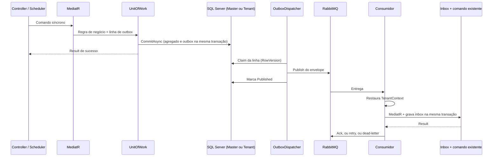

# Roadmap de Implementação: Mensageria Durável com RabbitMQ

Roadmap técnico para introduzir RabbitMQ no AdMetricsPro sem desmontar o monólito modular, o MediatR in-process nem o isolamento database-per-tenant.

Este documento é a ordem de construção. Nenhuma linha de produção de uma subfase começa antes do teste vermelho correspondente. O ciclo é o do `AGENTS.md`: teste que falha, implementação mínima, refatoração com XML docs e atualização de `/docs`.

A decisão formal entra em `docs/adr/0052-rabbitmq-integration-events-and-transactional-outbox.md` na Fase 0. Até lá, este roadmap é a especificação de trabalho.

---

## 1. Diagnóstico do que existe hoje

A comunicação entre módulos é in-memory, conforme o ADR 0009. Comandos e consultas passam por `ICommand` / `IQuery`, o `ValidationBehavior` converte FluentValidation em `Result.Failure`, e eventos de domínio saem embrulhados em `DomainEventNotification<T>` para `IDomainEventHandler<T>`.

Isso continua correto para qualquer operação que precise devolver `Result<T>` na mesma requisição HTTP. O limite aparece quando o efeito precisa sobreviver ao processo, ser reexecutado ou ser distribuído entre instâncias.

Há três furos concretos no código atual:

1. **Publicação depois do commit, sem durabilidade.** `SyncCampaignMetricsCommandHandler` grava as métricas com `IIntegrationsUnitOfWork.CommitAsync()` e só então chama `IPublisher.Publish` com `CampaignMetricsSyncedEvent`. `SocialPublishingUnitOfWork` faz `SaveChangesAsync` e, em seguida, publica os eventos do agregado via MediatR. Se o processo cai entre o commit e o `Publish`, Analytics, Automations e o restante dos handlers não ficam sabendo. Se um handler falha, o dado já está commitado e não há retentativa.
2. **Trabalho longo preso no host da API.** `Program.cs` sobe, no mesmo processo da Web API, `MetaSynchronizationWorker`, `SocialPublishingDispatchWorker`, `DunningBackgroundService` e `TrialNoticeBackgroundService`. O ciclo Meta percorre tenants, workspaces e contas em série, dentro de um único `BackgroundService`. Escalar a API para duas réplicas duplica esses laços. O claim por `RowVersion` de `PublicationJob` (ADR 0046) protege a publicação orgânica; os outros laços não têm essa proteção.
3. **Outbox local ainda não é transporte.** `social.PublicationJobs` já é uma outbox de verdade: idempotência, claim otimista, retentativa com `NextAttemptAtUtc`, dead-letter e kill switch `killswitch.social-publishing.dispatch`. Ela não atravessa processo. O ADR 0046 deixou fila externa fora daquela entrega de propósito. Este roadmap consome essa tabela; não a substitui.

Fora do broker, o frontend permanece como está. `WebApp` e `BackofficeApp` falam só com a Web API por `HttpClient` (ADR 0020). Nenhum dos dois abre conexão com RabbitMQ.

Testes de integração já sobem SQL Server com Testcontainers (`Testcontainers.MsSql` e `SqlServerFixture`). O broker de teste entra do mesmo jeito, com `Testcontainers.RabbitMq`.

---

## 2. Premissas travadas antes da Fase 1

1. **MediatR permanece o mediador síncrono.** Comando, consulta, validação e evento de domínio que precise acontecer dentro da mesma requisição continuam no pipeline do ADR 0009. RabbitMQ não devolve `Result<T>` para o controller.
2. **O broker recebe só o que já foi commitado.** A aplicação grava uma linha de outbox na mesma transação do agregado. Um dispatcher publica no RabbitMQ depois. É proibido chamar o broker dentro do handler HTTP antes do `CommitAsync`. O outbox do MassTransit preso a um único `DbContext` não serve como mecanismo único: cada tenant tem o próprio banco (ADR 0002) e o catálogo vive no `MasterDb`.
3. **Dois outboxes, um broker.** `MasterDb` guarda eventos do catálogo (provisionamento, e-mail de boas-vindas, cobrança, trial). O banco do tenant guarda eventos operacionais (métricas, publicação, relatório, job de IA). O envelope carrega `TenantId` quando o evento é do tenant. O consumidor restaura `ITenantContextAccessor` antes de abrir qualquer `DbContext`. Mensagem de tenant sem `TenantId` vai para dead-letter.
4. **MassTransit fica na borda de infraestrutura.** Contratos (`IIntegrationEvent`, gravador de outbox, política de ack) moram em `BuildingBlocks.Application` e `BuildingBlocks.Infrastructure`, sem pacote de broker. O transporte RabbitMQ fica em um projeto novo, `BuildingBlocks.Messaging`, referenciado por `WebApi` e pelos projetos de teste. `Domain`, `Application`, `WebApp` e `BackofficeApp` não referenciam MassTransit nem `RabbitMQ.Client`.
5. **Consumidor traduz mensagem em comando MediatR.** O handler de negócio já existe e já retorna `Result`. O consumidor não reimplementa regra. A política de ack está na seção 6.
6. **Agendamento continua no SQL.** A v1 não depende do plugin `rabbitmq_delayed_message_exchange`. Quem sabe o horário é a linha com `NextAttemptAtUtc` (ou o laço que já existe). O broker entrega trabalho pronto para executar agora.
7. **Escalar a API não pode duplicar o agendador.** Consumidores podem ter N réplicas. O processo que varre tenants e grava outbox (scheduler) precisa de lease no `MasterDb`, no mesmo espírito do claim do ADR 0046. Até esse lease existir, o host de mensageria roda em instância única.
8. **Carga útil mínima.** A mensagem leva identificadores, tipo, correlação e instante. Não leva token OAuth, connection string, senha SMTP nem corpo de e-mail renderizado. O consumidor relê o segredo no cofre do tenant ou nas opções do host.
9. **Kill switch.** O dispatcher respeita `killswitch.messaging.dispatch` (ADR 0015) antes de publicar. As flags já existentes (`Integrations:MetaSynchronization:Enabled`, `killswitch.social-publishing.dispatch`) continuam valendo dentro do comando.
10. **Frontend só enxerga a API.** Trabalho longo devolve um identificador de job no `Result<T>`. O Blazor consulta o status por `GET`. Não há cliente AMQP no browser nem no circuito SignalR.

---

## 3. O que fica no MediatR e o que vai para a fila

| Situação | Canal | Motivo |
| :--- | :--- | :--- |
| CRUD, login, RBAC, consulta de dashboard, validação de formulário | MediatR, resposta HTTP | O caller precisa do `Result<T>` na hora. |
| Evento de domínio cujo handler só altera estado já aberto na mesma transação | MediatR, antes ou durante o `CommitAsync` | Consistência local. Não atravessa processo. |
| E-mail transacional (boas-vindas, confirmação de assinatura, trial, dunning, convite) | Outbox do `MasterDb` → RabbitMQ | SMTP é lento e falha. O ADR 0049 já tem retry curto; a fila dá retentativa com o processo de pé e idempotência via `TenantNotificationLog`. |
| Sync de hierarquia e de métricas por conta de anúncio | Scheduler enfileira uma mensagem por conta | Hoje o `MetaSynchronizationWorker` faz tudo em série dentro da API. O comando `SyncCampaignMetrics` / `SyncCampaignHierarchy` permanece. |
| `CampaignMetricsSyncedEvent` e `CampaignHierarchySyncedEvent` | Outbox do tenant, publicados no mesmo commit da ingestão | Hoje saem depois do commit, só em memória. Pacing, travas e regras precisam dessa garantia. |
| Publicação orgânica no horário | `PublicationJob` continua a fonte da verdade; o dispatcher só enfileira job devido | ADR 0046. A fila não vira o agendador. |
| Geração de cópia, imagem Nano Banana, PDF white-label, disparo de relatório | Comando HTTP grava job + outbox e responde com o id | Chamadas a OpenAI, Gemini e geração de PDF não podem segurar o request Blazor. |
| Operação em massa que chama rede externa | Uma mensagem por item, com inbox | O ADR 0034 (arquivo `0034-bulk-cross-platform-campaign-operations.md`) tolera falha parcial. A fila evita estourar o timeout HTTP quando o lote chama Meta/Google/TikTok/Bing. |
| Migração de schema no startup | Hosted service atual | Não é mensagem de negócio. |

---

## 4. Topologia alvo

Um vhost `admetricspro`. Filas quorum. Nada de fila clássica espelhada.

| Peça | Nome | Papel |
| :--- | :--- | :--- |
| Exchange de publicação | `admetricspro.integration` (topic) | Dispatcher publica com routing key `{contexto}.{evento}.v{n}`, por exemplo `integrations.campaign-metrics-synced.v1`. |
| Fila por consumidor | `admetricspro.{modulo}.{consumidor}` | Cada handler tem a própria fila e o próprio bind. Dois módulos não compartilham fila. |
| Dead-letter | exchange `admetricspro.dead-letter` + fila `admetricspro.dead-letter` | Mensagem que esgotou retry ou que a política classificou como defeito permanente. |
| Retry curto | política MassTransit no consumidor (3 tentativas, backoff) | Falha transitória de rede, timeout, broker. |
| Retry longo (429, SMTP indisponível) | nova linha de outbox com `NextAttemptAtUtc` | Reusa o desenho de `OrganicPublishRateLimitPolicy`. Não segura canal AMQP. |

Cabeçalhos obrigatórios: `message-id` (igual ao `EventId`), `correlation-id`, `message-type`, `occurred-on-utc`, `tenant-id` (ausente só em evento de catálogo).

Prefetch baixo nos consumidores que chamam API de mídia (sugestão inicial: 1 a 4 por instância) para não furar o rate limit que o ADR 0027 já trata.

Docker Compose (dev e prod) ganha o serviço `rabbitmq` (`rabbitmq:4-management` em dev; em produção a imagem pode ser `rabbitmq:4` sem management). Healthcheck em `rabbitmq-diagnostics -q ping`. A Web API só sobe depois de `service_healthy`, no mesmo desenho do SQL no ADR 0038. Em produção as portas `5672` e `15672` não são publicadas no host; ficam na rede `admetricspro-prod-net`. Credenciais em `.env` / `.env.example`, no padrão do ADR 0018: `RabbitMQ__Host`, `RabbitMQ__Port`, `RabbitMQ__VirtualHost`, `RabbitMQ__Username`, `RabbitMQ__Password`, `Messaging__Enabled`, `Messaging__HostRole`.

`Messaging__HostRole` aceita `All` (padrão local: HTTP + scheduler + consumidor), `Api` (só HTTP e gravação de outbox), `Scheduler` (varre outbox e laços temporais) e `Consumer` (só consome). Enquanto houver uma réplica só, `All` reproduz o comportamento atual.

---

## 5. Fluxo de uma mensagem

O dispatcher marca `Published` só depois do ack do broker. Crash no meio deixa a linha `InProgress`; um reclaim por tempo (o furo deixado em aberto no ADR 0046) devolve a linha a `Pending`.

---

## 6. Política de ack a partir de `Result`

O consumidor nunca transforma falha de negócio em exceção para “forçar retry”.

| `Result` | Ação na mensagem | Exemplo |
| :--- | :--- | :--- |
| Sucesso | Ack. Grava inbox. | Métricas upsertadas, e-mail aceito pelo SMTP. |
| `ErrorType.Validation`, `NotFound`, `Conflict`, `Unauthorized` | Ack e registra a falha no log estruturado / linha de auditoria. Sem retry. | Conta desconectada, workspace inexistente, convite expirado. |
| Falha transitória explícita (rate limit, timeout, SMTP 4xx temporário) | Não dá ack definitivo. Reagenda via outbox com `NextAttemptAtUtc`. | HTTP 429 da Meta, `PublishRateLimitedError`. |
| Exceção inesperada | Retry curto do MassTransit. Esgotou → dead-letter. | Bug, broker, SQL fora. |
| `EventId` já presente na inbox | Ack imediato. | Reentrega. |

Códigos novos do módulo de mensageria:

| Código | Quando |
| :--- | :--- |
| `Messaging.Disabled` | `Messaging__Enabled=false`. O dispatcher não publica; a linha permanece `Pending`. |
| `Messaging.TenantRequired` | Evento operacional sem `TenantId`. Dead-letter. |
| `Messaging.PayloadInvalid` | Envelope sem `EventId`, tipo desconhecido ou JSON incompatível com a versão. Dead-letter. |
| `Messaging.LeaseNotAcquired` | Outra instância segura o lease de scheduler. Esta instância não varre. |
| `Messaging.PublishFailed` | Broker recusou a publicação. A linha volta a `Pending` com backoff. |

---

## 7. Tabela resumo das fases

| Fase | Objetivo | Onde mexe | Entregável |
| :--- | :--- | :--- | :--- |
| **0. Decisão** | Travar fronteira MediatR × fila e o ADR 0052. | `docs/` | ADR 0052, `docs/modules/messaging.md` vazio com o contrato, linha no catálogo de ADRs. |
| **1. Broker** | Subir RabbitMQ sem tráfego de negócio. | Compose, `.env.example`, health da API | Serviço saudável, credencial fora do Git, `/health` degradado se o broker obrigatório estiver fora. |
| **2. Contratos** | Envelope, porta de outbox e política de ack testáveis sem broker. | `BuildingBlocks.Application`, `BuildingBlocks.Domain` | Tipos, testes unitários, zero referência a MassTransit. |
| **3. Outbox e dispatcher** | Gravar na mesma transação, publicar, reclaim, inbox. | `BuildingBlocks.Infrastructure`, `BuildingBlocks.Messaging`, `WebApi` | Tabelas no Master e no tenant, dispatcher com lease, Testcontainers RabbitMQ. |
| **4. E-mail** | Primeira fatia vertical, baixo risco. | `Master` | Boas-vindas e confirmação de assinatura saem da fila. Provisionamento não espera o SMTP. |
| **5. Sync de mídia** | Uma mensagem por conta, consumidores horizontais. | `Integrations`, `WebApi/Background` | `MetaSynchronizationWorker` vira agendador. Google, TikTok e Bing entram pelo mesmo contrato quando o adaptador existir. |
| **6. Eventos de ingestão** | Tornar duráveis os eventos que hoje nascem depois do commit. | `Integrations`, `Analytics`, `Automations` | `CampaignMetricsSynced` e `CampaignHierarchySynced` pela outbox. Regras, pacing e travas reagem com inbox. |
| **7. Publicação orgânica** | Levar o job devido ao consumidor sem trocar a outbox do ADR 0046. | `SocialPublishing` | `SocialPublishingDispatchWorker` enfileira; o consumidor chama `DispatchDuePublicationsCommand` por job. |
| **8. Jobs de usuário** | Tirar IA, PDF e lote externo do request. | Social, Reports, Integrations, Blazor (só cliente HTTP) | `202` semântico no `Result`, tela consulta status. |
| **9. Régua Master** | Dunning e trial deixam de enviar e-mail dentro do laço. | `Master` | O laço só decide “está na janela” e grava outbox. |
| **10. Operação** | Multi-instância, dead-letter visível, runbook. | `docs/devops`, Backoffice (leitura) | Papéis `Api` / `Scheduler` / `Consumer`, consulta de dead-letter, métricas. |

Cada fase fecha com XML `
` / `<param>` / `<returns>`, atualização de `docs/modules/messaging.md` e, quando mudar comportamento de módulo já documentado, um parágrafo no `.md` daquele módulo. Não há endpoint novo de negócio nas fases 1–3. A partir da fase 8, endpoint novo leva `[EndpointSummary]`, `[ProducesResponseType]` e entrada no Scalar.

---

## 8. Fases em detalhe

### Fase 0 — Decisão e fronteira

Objetivo: escrever a decisão antes do pacote NuGet. Nenhuma referência a RabbitMQ no `.csproj` nesta fase.

* **0.1:** Criar o ADR 0052 no formato Nygard (Status, Contexto, Decisão, Consequências) cobrindo as premissas da seção 2, a rejeição do outbox único do MassTransit como fonte de verdade e a manutenção do ADR 0009 e do ADR 0046.
* **0.2:** Acrescentar a linha 0052 em `docs/adr/README.md`.
* **0.3:** Abrir `docs/modules/messaging.md` com o diagnóstico da seção 1, a tabela da seção 3, o catálogo de erros e a frase “sem endpoint HTTP nesta fase”.

### Fase 1 — Broker no ambiente

Objetivo: o container existe, a API sabe se ele está vivo, e nenhum handler publica mensagem.

* **1.1 (TDD - Red):** Teste do health check: com `Messaging__Enabled=true` e broker inacessível, o check `rabbitmq` fica `Unhealthy`. Com `Enabled=false`, o check fica ausente ou `Healthy` e a API sobe como hoje.
* **1.2 (TDD - Green):** Serviço `rabbitmq` em `docker-compose.yml` e `docker-compose.prod.yml`. Dev publica `5672` e `15672` em localhost. Prod não publica porta. `webapi.depends_on` com `service_healthy` apenas quando a feature estiver ligada no compose de dev; em prod, a mesma condição, porque o dispatcher futuro não pode subir no escuro.
* **1.3:** Variáveis no `.env.example` e, se o template de produção existir, no `.env.prod.example`. Senha só por ambiente. Atualizar `docs/devops/docker-production.md` com a rede interna e a proibição de expor o management.
* **1.4:** `AddRabbitMqHealthCheck` condicionado a `Messaging:Enabled`. O endpoint `/health` que o compose já usa continua respondendo; o check novo é nomeado, para o compose não derrubar a API inteira por um broker desligado em ambiente que ainda roda `Enabled=false`.

Critério de saída: `docker compose up` sobe o RabbitMQ saudável e a suíte atual permanece verde com `Messaging__Enabled=false`.

### Fase 2 — Contratos sem broker

Objetivo: o domínio da mensagem existe e a política de ack é pura.

* **2.1 (TDD - Red):** Testes de `IntegrationEventEnvelope` rejeitam `EventId` vazio, tipo em branco e evento de tenant sem `TenantId`. Evento de catálogo (`TenantId` nulo) é aceito. Serialização JSON estável (nomes explícitos, sem dependência de ordem de propriedade do record).
* **2.2 (TDD - Red):** Testes da política `IntegrationResultDisposition` cobrindo as cinco linhas da seção 6, inclusive “rate limit reagenda” versus “conflict dá ack”.
* **2.3 (TDD - Green):** Records em `BuildingBlocks.Application.Messaging`: `IIntegrationEvent`, `IntegrationEventEnvelope`, `IntegrationResultDisposition`. A entidade `IntegrationOutboxMessage` (id, tipo, payload, `TenantId` opcional, status, tentativas, `NextAttemptAtUtc`, `RowVersion`, `EventId` único) fica no kernel de domínio ou na infraestrutura compartilhada, com os mesmos status já usados em espírito por `PublicationJob`: `Pending`, `InProgress`, `Published`, `DeadLetter`.
* **2.4 (Compliance):** Estender `AgentsArchitectureComplianceTests` para falhar se `WebApp`, `BackofficeApp` ou qualquer `*.Application` / `*.Domain` referenciar `MassTransit` ou `RabbitMQ.Client`.
* **2.5:** XML docs e a seção de contratos em `docs/modules/messaging.md`.

### Fase 3 — Outbox transacional, dispatcher e inbox

Objetivo: uma mensagem de teste atravessa SQL → RabbitMQ → consumidor idempotente, com tenant restaurado. Ainda sem e-mail real e sem Meta.

* **3.1 (TDD - Red):** Teste de integração com `SqlServerFixture`: no mesmo `SaveChanges`, o agregado e a linha `messaging.IntegrationOutboxMessages` commitam juntos. Falha provocada antes do save não deixa linha. `EventId` duplicado viola índice único.
* **3.2 (TDD - Red):** Dois dispatchers concorrentes reivindicam a mesma linha; só um recebe o claim (`RowVersion`, igual ao `TryClaimAsync` da publicação orgânica). Linha `InProgress` mais velha que o timeout volta a `Pending`.
* **3.3 (TDD - Red):** Consumidor de laboratório (`PingIntegrationEvent`) processa duas entregas do mesmo `EventId` e o efeito colateral ocorre uma vez (inbox única por `EventId` + nome do consumidor). Mensagem com `TenantId` define `ITenantContextAccessor` antes do comando; mensagem operacional sem tenant não abre banco.
* **3.4 (TDD - Green):** Configuração EF reutilizável, aplicada ao `MasterDbContext` e a um `DbContext` de tenant (o operacional ou um contexto de mensageria no mesmo banco — uma história de migração só, sem um quarto banco). Migração automática no fluxo já existente do ADR 0008: Master no startup, tenant no provisionamento.
* **3.5 (TDD - Green):** Projeto `BuildingBlocks.Messaging` com MassTransit e transporte RabbitMQ. Registro `AddAdMetricsMessaging(configuration)` usado só pela `WebApi`. Publicação real coberta por Testcontainers (`Testcontainers.RabbitMq`), no padrão de `SqlServerFixture`. O teste sobe os dois containers.
* **3.6 (TDD - Green):** `OutboxDispatchWorker` (`BackgroundService`) lê `Messaging:Dispatch` (`Enabled`, intervalo ≥ 5 segundos). Avalia `killswitch.messaging.dispatch` antes do laço. Lease em tabela do `MasterDb` (`MessagingSchedulerLease`, expiração, renovação). Quem não pega o lease registra `Messaging.LeaseNotAcquired` e não publica.
* **3.7:** Filtro de consumidor que rejeita payload inválido com `Messaging.PayloadInvalid` e não chama MediatR.
* **3.8:** Documentar o reclaim, o lease e o inbox em `docs/modules/messaging.md`. Atualizar o ADR 0052 com o nome físico das tabelas se a fase 0 tiver deixado isso em aberto.

Critério de saída: com `Messaging__Enabled=false`, nenhum worker novo publica e os testes antigos passam. Com `Enabled=true`, o ping de laboratório completa o circuito da seção 5.

### Fase 4 — Fatia vertical: e-mail transacional

Objetivo: o primeiro fluxo real. Provisionar tenant e ativar assinatura continuam retornando sucesso mesmo se o SMTP estiver fora. O e-mail sai pela fila e a idempotência que já existe em `TenantNotificationLog` permanece.

Handlers atuais, que passam a ser chamados pelo consumidor e não mais no meio do request:

* `TenantProvisionedSendWelcomeEmailEventHandler`
* `TenantSubscriptionActivatedSendConfirmationEmailHandler`

* **4.1 (TDD - Red):** O handler de provisionamento, ao commitar, persiste a outbox do evento de boas-vindas e não chama `IEmailSender` na mesma chamada. Reexecução do consumidor com o mesmo `EventId` não envia segundo e-mail (`TenantNotificationLog`).
* **4.2 (TDD - Red):** Falha transitória de SMTP reagenda `NextAttemptAtUtc`. Falha permanente (destinatário inválido) dá ack e grava o erro, sem loop.
* **4.3 (TDD - Green):** `TenantProvisioningService` e o fluxo de ativação gravam o envelope no commit do Master. Remover o `IPublisher.Publish` fire-and-forget desses dois caminhos só depois do teste verde do consumidor. Os eventos de domínio continuam existindo para auditoria in-process que não chama rede.
* **4.4:** O consumidor abre escopo, não precisa de `ITenantContext` de banco de tenant para e-mail de catálogo, e despacha o comando/handler já testado.
* **4.5:** Atualizar `docs/modules/transactional-emails-and-trial-notices.md` e um adendo curto no ADR 0023 apontando para o ADR 0052. Não reescrever o ADR 0023.

Fora desta fase: trial notice e dunning (fase 9). Convite de equipe entra aqui só se o envio já estiver no mesmo `IEmailSender` e o teste de idempotência for o mesmo; caso o convite ainda seja síncrono no request de quem convida, deixar o request síncrono até a fase 9 para não mudar a UX de erro na tela.

### Fase 5 — Sincronização de contas de anúncio

Objetivo: o laço deixa de chamar a API da Meta dentro do worker. Ele só descobre trabalho e grava uma mensagem por conta.

* **5.1 (TDD - Red):** Dado um catálogo com dois tenants e três contas Meta conectadas, o scheduler grava três outboxes e não chama `SyncCampaignHierarchy` nem `SyncCampaignMetrics` no processo do scheduler. Conta demo, desconectada ou tenant fora de `Active`/`Trial` não gera mensagem. O recorte é o mesmo de `MetaSynchronizationWorker.RunCycleAsync`.
* **5.2 (TDD - Red):** Consumidor com `TenantId` executa os dois comandos já existentes (hierarquia, depois métricas no lookback configurado). `429` reagenda. `Result` de validação dá ack. Duas entregas da mesma conta e da mesma janela não duplicam `CampaignMetric` (a chave única do ADR 0028 continua sendo a garantia).
* **5.3 (TDD - Green):** `MetaSynchronizationWorker` passa a usar o gravador de outbox quando `Messaging:Enabled` é true. Com `Enabled=false`, o comportamento atual permanece, para rollback operacional sem deploy de código.
* **5.4:** Prefetch do consumidor de sync documentado e configurável (`Messaging:Consumers:MediaSync:Prefetch`). Métrica `admetrics.messaging.dispatch` ao lado do meter `AdMetricsPro.MetaSynchronization` que já existe.
* **5.5:** Atualizar `docs/modules/integrations-campaign-hierarchy-sync.md` e `docs/modules/integrations-campaign-metrics-ingestion.md`.

Google, TikTok e Bing não ganham adaptador novo nesta fase. O contrato da mensagem já carrega `Platform` e `ConnectedAdAccountId` para o consumidor futuro usar o dispatcher que o ADR 0028 descreve.

### Fase 6 — Eventos duráveis depois da ingestão

Objetivo: `CampaignMetricsSyncedEvent` e `CampaignHierarchySyncedEvent` deixam de ser um `Publish` depois do commit.

* **6.1 (TDD - Red):** O commit da ingestão e a outbox do evento entram na mesma transação do banco do tenant. Derrubar o publicador in-memory não perde o evento: o dispatcher publica a linha.
* **6.2 (TDD - Red):** Consumidores de Analytics (taxonomia, moeda) e de Automations (avaliação de regras, pacing, travas) processam com inbox. A avaliação em si continua no `RuleConditionEvaluator` e nos comandos MediatR atuais (`PauseCampaignCommand`, `AdjustCampaignBudgetCommand`, etc.). O módulo Automations não referencia repositório de Integrations.
* **6.3 (TDD - Green):** Remover o `Publish` pós-commit em `SyncCampaignMetricsCommandHandler` e o equivalente da hierarquia, substituídos pela linha de outbox coletada antes do `SaveChanges`.
* **6.4:** Documentar em `docs/modules/automations-rules.md`, `docs/modules/automations-budget-pacing.md` e `docs/modules/automations-safety-guards.md` que o gatilho passou a ser integração durável. A DSL não muda.

Ordem obrigatória dentro da fase: inbox e consumidor verdes antes de apagar o `Publish` in-memory. Os dois caminhos não ficam ativos juntos, para não executar a regra duas vezes.

### Fase 7 — Publicação orgânica

Objetivo: preservar `PublicationJob` como agenda e idempotência. A fila só executa o que já está devido.

* **7.1 (TDD - Red):** O worker, com mensageria ligada, não chama o adaptador `PublishAsync`. Para cada job `Pending`/`RetryScheduled` vencido que ele consiga marcar como encaminhado, grava uma mensagem `PublishOrganicSlot` com `TenantId`, `PublicationJobId` e a chave de idempotência `{postId}:{scheduledAtUtc}`. Job `InProgress` não é reenfileirado.
* **7.2 (TDD - Red):** O consumidor invoca o comando de disparo já existente para aquele job. Rate limit continua em `RetryScheduled` no SQL, não em delayed exchange. Kill switch `killswitch.social-publishing.dispatch` segue sendo checado antes da chamada externa.
* **7.3 (TDD - Green):** Caminho `Messaging:Enabled=false` mantém `SocialPublishingDispatchWorker` como está no ADR 0046.
* **7.4:** Atualizar `docs/modules/social-publishing.md` (seção da outbox) e um adendo no ADR 0046. O ADR 0046 não é revogado: a tabela continua sendo a fonte da verdade.

O reclaim de job `InProgress` órfão, citado como lacuna no ADR 0046, entra nesta fase se ainda não existir: timeout configurável devolve o job a `RetryScheduled` antes de qualquer publish no broker.

### Fase 8 — Trabalho iniciado pelo usuário

Objetivo: request HTTP curto para IA, relatório e mutação externa em lote. O Blazor continua em `HttpClient`.

Escopo, nesta ordem:

1. Geração de cópia e de imagem (`GenerateSlotCopyCommand`, Nano Banana / ADR 0051).
2. Compilação de PDF e disparo de relatório (ADR 0037).
3. Item de `BulkCampaignOperationCommand` cuja mutação saia para a API da rede. A validação local e o retorno parcial do ADR de operações em massa continuam; o que muda é a chamada externa, que deixa de ocupar o request quando o lote for grande.

* **8.1 (TDD - Red):** O comando de geração persiste um job `Accepted` e a outbox, e o `Result` traz o id. Não chama o cliente HTTP da IA no handler do request.
* **8.2 (TDD - Red):** `GET` do job devolve `Accepted`, `Running`, `Succeeded`, `Failed` com o erro de negócio quando houver. Segunda entrega do mesmo `EventId` não chama o provedor de novo.
* **8.3 (TDD - Green):** Endpoint versionado em `/api/v1/...` com `[EndpointSummary]` e `[ProducesResponseType]` (200 no GET, 202 não é obrigatório se o envelope `Result<T>` já carrega o estado `Accepted`; documentar o código HTTP escolhido no módulo e usar um só). Cliente tipado no `WebApp`. A página que hoje espera a IA passa a disparar e a consultar o status. Sem MediatR e sem `DbContext` no frontend.
* **8.4:** Repetir o par Red/Green para relatório sob demanda e, por último, para o item de lote que chama rede. O preview de impacto orçamentário do Blazor permanece síncrono: ele não chama a rede.
* **8.5:** Verificação manual no browser do fluxo alterado (disparar geração, ver estado pendente, ver sucesso e ver falha de provedor). Teste bUnit do componente que deixa de assumir resposta imediata.

### Fase 9 — Dunning e régua de trial

Objetivo: `DunningBackgroundService` e `TrialNoticeBackgroundService` continuam donos da janela temporal (`TrialNoticePolicy`, carência, intervalo de retry). Eles deixam de falar com o SMTP.

* **9.1 (TDD - Red):** Um ciclo com três tenants na janela grava três outboxes e zero chamadas ao sender. Tenant fora da janela não grava. Reexecução do ciclo não duplica o log de notificação.
* **9.2 (TDD - Green):** Consumidor reutiliza o handler de e-mail da fase 4 e a disposição de `Result` da seção 6.
* **9.3:** Atualizar `docs/modules/transactional-emails-and-trial-notices.md` e `docs/modules/backoffice-dunning.md`.

### Fase 10 — Operação com mais de uma instância

Objetivo: poder subir a API em réplica sem disparar sync, dunning e publicação em dobro, e poder olhar uma mensagem envenenada sem abrir o management na internet.

* **10.1:** `Messaging__HostRole` efetivo. Teste de composição: role `Api` não registra `OutboxDispatchWorker` nem os schedulers Meta/Social/Dunning/Trial. Role `Consumer` não registra esses schedulers e registra os consumidores. Role `Scheduler` registra dispatcher e schedulers, não registra consumidores. Role `All` registra tudo (dev e instalação de uma instância).
* **10.2:** Lease coberto na fase 3 passa a ser obrigatório para qualquer role que rode scheduler, com teste de duas instâncias `Scheduler`.
* **10.3:** Consulta interna, só Backoffice, de linhas `DeadLetter` (tipo, tenant, tentativas, último erro, `EventId`). Reprocessar republica uma outbox nova com o mesmo payload e outro `EventId` de tentativa, guardando o id original em `correlation-id`. Não é edição livre de JSON na tela.
* **10.4:** Métricas: profundidade não fica a cargo do backoffice (isso é do broker). A API expõe contadores de publicado, ack, reagendado e dead-letter. Runbook em `docs/devops/docker-production.md`: broker fora, kill switch, reclaim, como drenar uma fila sem perder outbox (a fonte da verdade continua no SQL enquanto `Published` não foi gravado).
* **10.5:** Teste de arquitetura garantindo que o role `Api` consegue gravar outbox sem conexão de consumidor ativa, para um deploy em que o broker cai depois do commit HTTP. A mensagem espera no SQL.

---

## 9. Fora de escopo

* Trocar o MediatR por RabbitMQ em comando ou consulta síncrona.
* Extrair módulos para outros deployáveis. O consumidor roda no mesmo binário, com role diferente. Microsserviço fica para outro ADR, se um dia o módulo precisar de ciclo de vida próprio.
* Plugin de delayed message, Kafka, Redis Streams ou um segundo broker.
* Publicar evento de cada clique de UI ou invalidar cache de Blazor pela fila.
* Colocar connection string, token ou senha no corpo da mensagem.
* Reescrever `PublicationJob`, a chave única de `CampaignMetric` ou o `TenantNotificationLog`. Eles continuam sendo a idempotência de negócio; a inbox é a idempotência de transporte.
* Tela de administração do RabbitMQ Management no Backoffice.

---

## 10. Riscos e como a ordem das fases os segura

| Risco | Onde é tratado |
| :--- | :--- |
| Perder evento entre `SaveChanges` e `Publish` | Fase 3 grava a outbox na mesma transação. Fases 4 e 6 só migram o fluxo real depois disso. |
| Processar duas vezes e pausar campanha ou enviar e-mail em dobro | Inbox na fase 3, mais as chaves que já existem (`TenantNotificationLog`, `CampaignMetric`, `PublicationJob`). |
| Consumidor abrir o banco do tenant errado | `TenantId` obrigatório no envelope e filtro que dead-letter antes do `DbContext` (fase 3). |
| Duas réplicas da API varrerem a Meta ao mesmo tempo | Flag `Enabled=false` por padrão nos workers atuais; lease na fase 3; roles na fase 10. Até a fase 10, produção de mensageria fica em uma instância `All`. |
| Retry infinito de erro de negócio | Seção 6: validação, not found e conflict dão ack. |
| MassTransit vazar para o Blazor ou para o domínio | Teste de compliance na fase 2. |
| Fila virar segunda fonte da verdade da publicação orgânica | Fase 7 não move o agendamento para o broker. |
| SMTP ou Meta fora derrubarem o provisionamento ou o request | Fases 4, 5 e 8: o `Result` do HTTP não espera a rede externa. |

---

## 11. Critério de aceite do roadmap

A mensageria está implantada quando todos os itens abaixo são verdadeiros:

* [ ] ADR 0052 aceito e `docs/modules/messaging.md` descreve envelope, outbox, inbox, ack e kill switch.
* [ ] `Messaging__Enabled=false` deixa o comportamento atual de workers e de e-mail intacto.
* [ ] Nenhum projeto `Domain`, `Application`, `WebApp` ou `BackofficeApp` referencia MassTransit ou `RabbitMQ.Client`.
* [ ] Outbox do Master e do tenant commita na mesma transação do fato de negócio, com teste de integração em SQL Server real.
* [ ] Dispatcher com lease, reclaim de `InProgress` e dead-letter cobertos por teste.
* [ ] E-mail de boas-vindas e de assinatura, sync Meta por conta, eventos de métricas/hierarquia e publicação orgânica devida passam pela fila com idempotência comprovada.
* [ ] Jobs de IA e de relatório respondem no request com identificador e a tela consulta o status pela Web API.
* [ ] Compose de produção não publica a porta do broker nem a do management.
* [ ] XML docs nos tipos públicos novos e Scalar atualizado nos endpoints novos da fase 8.
